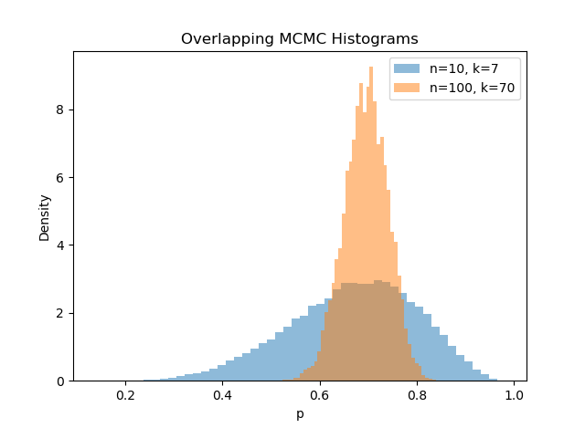

## Bayes' Law
 
Bayesian statistics is an interpretation of probability built around updating your view of the world as new information comes in, and Bayes' Law is what formalises this. This section goes through some standard interview questions, along with a few less standard ones that should help build intuition for what the Bayesian process is actually doing.
 
Bayes' Law states that:
 
$$
P(A \mid B) = \frac{P(B \mid A)P(A)}{P(B)}
$$
 
A quick derivation:
 
$$
P(A \cap B) = P(A \mid B)P(B) = P(B \mid A)P(A)
$$
 
, and rearranging gives the result.
 
In Bayes' Law, $P(A)$ is called the **prior probability**, $P(B \mid A)$ is the **likelihood** (of observing the result given $A$), and $P(A \mid B)$ is the **posterior**. $P(B)$ can be thought of as a normalising constant that ensures $\int_{A} P(A\mid B)\, dA = 1$. Beyond specific uses of Bayes' Law, this language of updating priors on new information to form posteriors is a big part of trader discourse.
 
---
 
### 1. Late Computers:
 
#### Question:
 
Company A supplies 40% of the computers sold and is late 5% of the time. Company B supplies 30% of the computers sold and is late 3% of the time. Company C supplies the remaining 30% and is late 2.5% of the time. A computer arrives late - what is the probability that it came from Company A?
 
#### Answer:
 
Let $L$ denote the event that the computer arrives late. We need $P(L)$, which comes from the law of total probability. In general, if $\{A_1, A_2, \dots, A_n\}$ is a partition of the sample space (i.e. mutually exclusive and exhaustive events), then for any event $B$,
 
$$
P(B) = \sum_{i=1}^{n} P(B \mid A_i)\,P(A_i).
$$
 
Here the suppliers form the partition, so
 
$$
P(L) = \sum_{S_i \in \text{suppliers}} P(S_i) P(L \mid S_i)
$$
 
$$
P(L) = 0.4(0.05) + 0.3(0.03) + 0.3(0.025) = 0.0365
$$
 
Then by Bayes' Law,
 
$$
P(A \mid L) = \frac{P(L \mid A)P(A)}{P(L)}
$$
 
$$
P(A \mid L) = \frac{0.05(0.4)}{0.0365} \approx 0.55
$$
 
---
 
### 2. A Rare Disease:
 
#### Question:
 
A disease affects 1% of the population. A diagnostic test for the disease has:
 
- a **99% sensitivity** (the probability of testing positive given that one has the disease), and
- a **5% false positive rate** (i.e. it incorrectly identifies 5% of healthy people as having the disease).
A randomly selected person takes the test and gets a **positive result**.
 
**What is the probability that they actually have the disease?**
 
#### Answer:
 
Let $A$ be the event that someone has the disease (prior to testing), and $B$ the event that they test positive. We want $P(A \mid B)$.
 
From the question:
 
- $P(A) = 0.01$
- $P(B \mid A) = 0.99$
- $P(B \mid \bar{A}) = 0.05$
As before, the law of total probability gives $P(B)$:
 
$$
P(B) = P(B\mid A)P(A) + P(B \mid \bar{A})P(\bar{A})
$$
 
$$
P(B) = 0.99(0.01) + 0.05(0.99) = 0.0594
$$
 
Now apply Bayes' Law:
 
$$
P(A \mid B) = \frac{P(B \mid A)P(A)}{P(B)}
$$
 
$$
= \frac{0.99 \times 0.01}{0.0594} = \frac{1}{6}
$$
 
This can also be understood via odds. Since $P(B \mid A)P(A)$ is a fifth of $P(B \mid \bar{A})P(\bar{A})$, a positive result is 5 times as likely to be a false positive as a true one, giving $\frac{5}{6} \text{ vs } \frac{1}{6}$ as the respective probabilities.
 
---
 
### 3. Coin from a Bag:
 
#### Question:
 
A bag contains three coins: two are fair and one is double-headed. You pick one at random, flip it three times, and get three heads. What is the probability that you picked the double-headed coin? What is the probability that the next flip is a head?
 
#### Answer:
 
First work out which coin you are likely holding using Bayes' Law; the second part then follows directly.
 
Define the following events:
 
- $D$ is having picked the double-headed coin
- $H_3$ is getting three heads from three flips
, with the following information known:
 
- $P(D) = \frac{1}{3}$, $P(\bar{D}) = \frac{2}{3}$
- $P(H_3 \mid D) = 1$
- $P(H_3 \mid \bar{D}) = \left(\frac{1}{2}\right)^3 = \frac{1}{8}$
By the law of total probability,
 
$$
P(H_3) = 1\left(\frac{1}{3}\right) + \frac{1}{8}\left(\frac{2}{3}\right) = \frac{5}{12}
$$
 
and by Bayes' Law,
 
$$
P(D \mid H_3) = \frac{P(H_3 \mid D)P(D)}{P(H_3)} = \frac{\frac{1}{3}}{\frac{5}{12}} = \frac{4}{5}
$$
 
In odds form: the prior odds of double-headed vs fair are $1:2$, and each head is twice as likely under the double-headed coin, so three heads multiply the odds by $8$, giving $8:2 = 4:1$, i.e. $\frac{4}{5}$.
 
The next flip is a head with probability 1 if the coin is double-headed and $\frac{1}{2}$ otherwise:
 
$$
P(\text{Next flip H}) = 1 \cdot \frac{4}{5} + \frac{1}{2} \cdot \frac{1}{5} = \frac{9}{10}
$$
 
---
 
### 4. Monty Hall:
 
#### Question:
 
You are on a game show with three doors. Behind one is a car, and behind the other two are goats. You pick door 1. The host, who knows where the car is, opens door 3 to reveal a goat and offers you the chance to switch to door 2. Should you switch? Does your answer change if the host doesn't know where the car is, and just happened to open a door with a goat behind it?
 
#### Answer:
 
Let $C_i$ be the event that the car is behind door $i$, so $P(C_i) = \frac{1}{3}$ for each door, and let $O_3$ be the event that the host opens door 3 and reveals a goat. The host never opens your door.
 
**Host knows where the car is.** He always reveals a goat, choosing at random if he has a choice:
 
- $P(O_3 \mid C_1) = \frac{1}{2}$ (doors 2 and 3 both hide goats)
- $P(O_3 \mid C_2) = 1$ (door 3 is his only option)
- $P(O_3 \mid C_3) = 0$
By the law of total probability,
 
$$
P(O_3) = \frac{1}{2}\left(\frac{1}{3}\right) + 1\left(\frac{1}{3}\right) + 0 = \frac{1}{2}
$$
 
and by Bayes' Law,
 
$$
P(C_1 \mid O_3) = \frac{\frac{1}{2} \cdot \frac{1}{3}}{\frac{1}{2}} = \frac{1}{3}, \quad P(C_2 \mid O_3) = \frac{1 \cdot \frac{1}{3}}{\frac{1}{2}} = \frac{2}{3}
$$
 
, so you should switch.
 
**Host doesn't know.** He opens door 2 or 3 at random, and we observe that he happened to open door 3 and it happened to be a goat:
 
- $P(O_3 \mid C_1) = \frac{1}{2}$
- $P(O_3 \mid C_2) = \frac{1}{2}$
- $P(O_3 \mid C_3) = 0$ (he would have revealed the car)
Now $P(O_3) = \frac{1}{3}$ and $P(C_1 \mid O_3) = P(C_2 \mid O_3) = \frac{1}{2}$, so switching makes no difference.
 
The thing to take away is that what you observe is identical in both cases, but the likelihood is not, because it depends on the process that generated the observation. A knowing host opening door 3 is evidence for door 2; an ignorant host doing the same is not.
 
---
 
### 5. Coin Game:
 
#### Question:
 
You pick a random biased coin with $P(H) \sim U(0, 1)$, flip it 10 times and get 7 heads. Make a centered 95% confidence interval on $P(H)$. What if you flip it 100 times and get 70 heads?
 
#### Answer:
 
The intuition is that the CI for 10 flips should be skewed more towards $P(H) = 0.5$ than the CI for 100 flips, because you are updating less towards the observed value: the difference in likelihood of 7 heads from 10 under $P(H) = 0.5$ vs $P(H) = 0.7$ is much smaller than the difference in likelihood of 70 heads from 100 under the same two values. The CI should also be much tighter for the 100 flip trial. This should be enough in practice if you get this question, but I will also plot the distribution of $P(H \mid \text{Observed result})$ for both results. This needs something called MCMC, which you are not expected to know in the least, but is required to actually get the final answer.
 

 
, with the below results:
 
| Metric                   | Trial 1 (10 flips) | Trial 2 (100 flips) |
|--------------------------|-------------------:|--------------------:|
| Mean                     | 0.6681             | 0.6955              |
| Median                   | 0.6778             | 0.6971              |
| 95% Confidence Interval  | (0.4347, 0.8657)   | (0.6182, 0.7678)    |
 
